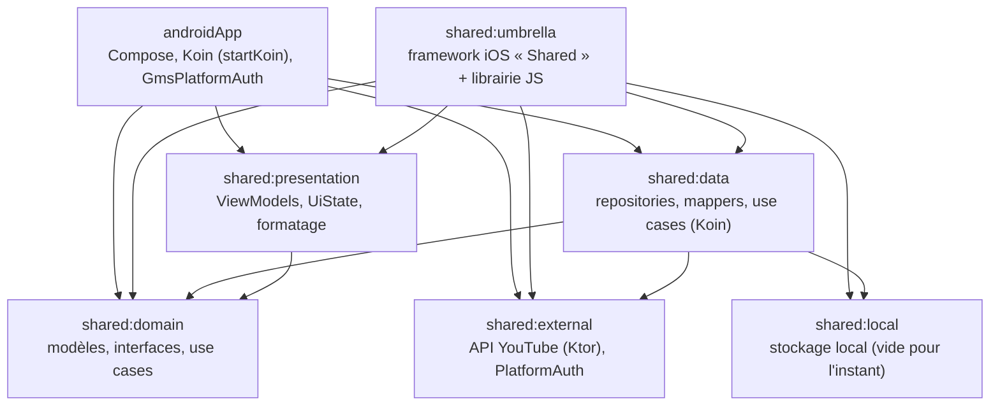

# ytblight — règles pour Claude

Client YouTube perso (Android, iOS, Web). Logique métier en Kotlin Multiplatform (`shared/`), interface native par plateforme. Voir `README.md` pour l'avancement et l'architecture.

## Langue
- Interface de l'app, commentaires, KDoc, commits et PR : **français**.
- Identifiants de code : anglais.
- **Android : aucun texte en dur dans les composables.** Tous les textes affichés sont dans `androidApp/src/main/res/values/strings.xml` et lus avec `stringResource(R.string...)`.

## Contraintes produit (ne pas contourner)
- Mode sombre uniquement, français uniquement, navigation en portrait (paysage seulement sur l'écran du lecteur).
- Aucun suivi, aucune statistique, aucun rapport d'erreur. Rien de stocké en local hors ce qu'exige la connexion.
- Pas de backend, pas de clé d'API : jeton OAuth uniquement.
- Pas de délai minimal de rafraîchissement ni de limite en jours sur le fil (décision explicite).

## Style de code
- **Signatures** : dès le premier paramètre (fonction) ou attribut (classe), un par ligne, virgule finale, y compris pour un seul :

  ```kotlin
  fun updateUserProfile(
      userId: String,
      isActive: Boolean = true,
  ): Boolean {
      return true
  }

  class UserProfile(
      val userId: String,
  )
  ```

  Appliqué par ktlint via `.editorconfig` (`./gradlew ktlintFormat`). Mêmes principes en Swift et TypeScript.
- **Appels** de fonctions et constructeurs **du projet** : arguments nommés, un par ligne, virgule finale, y compris pour un seul argument :

  ```kotlin
  updateUserProfile(
      userId = userId,
      isActive = false,
  )
  ```

  Non appliqué à la bibliothèque standard ni aux bibliothèques tierces (`assertEquals`, `listOf`, `Modifier.padding`…) ni à l'appel d'un paramètre de type fonction (`onClick()`). Non vérifié par ktlint : à respecter à la main.
- **Références de fonction plutôt que lambda de simple transfert** : `onClose = navController::popBackStack` et non `onClose = { navController.popBackStack() }` ; de même `.also(list::add)`, `.mapNotNull(VideoDto::toDomainOrNull)`. Les accès à une propriété (`map { it.id }`) restent en lambda.
- Indentation de 4 espaces, lignes ≤ 120 caractères.

## Architecture
- **Un ViewModel par page** (jamais de ViewModel global). Pages : `splash`, `signin`, `feed`, `player`. Un package par page dans chaque module : `shared/presentation/.../<page>/<Page>ViewModel.kt` (+ `<Page>UiState`) et `androidApp/.../ui/<page>/<Page>Route.kt`. Les ViewModels restent dans `shared` pour servir aussi SwiftUI et React.
- **Fichier `<Page>Route.kt`** : toujours deux fonctions `@Composable`. La première, publique (`<Page>Route`), obtient le ViewModel via Koin (`val viewModel: XViewModel = koinViewModel()`), collecte l'état, gère la navigation, puis appelle la seconde. La seconde, privée (`<Page>Screen`), ne contient que l'interface : elle ne reçoit ni ViewModel ni Koin, seulement un état et des lambdas.
- **Un ViewModel ne parle jamais à un repository** : il passe toujours par un use case du `domain` (`GetFeedUseCase`, `CheckSessionUseCase`, `SignInUseCase`, `CompleteConsentUseCase`, `SignOutUseCase`…), même quand il se limite à déléguer.
- **Aucun faux code dans le code de production**, et **une seule version de chaque fake** : les fausses données partagées (`FakeAuthRepository`, `FakeFeedRepository`, `testVideo`) sont dans `shared/test-fixtures/kotlin`, un dossier de sources (pas un module) ajouté aux sources de test de chaque module (`commonTest`, `androidTest`) par leur `build.gradle.kts`. Elles ne sont compilées que dans les tests. Un fake propre à un seul test (par exemple `ScriptedRepository`) reste dans ce test. Côté Android, `fakeModule` (Koin) remplace les repositories réels.
- **Connexion Google** : le flux est piloté par `SignInViewModel` → `SignInUseCase` / `CompleteConsentUseCase` → `AuthRepository` → `PlatformAuth` (implémenté par la plateforme : `GmsPlatformAuth` sur Android, qui traduit aussi les exceptions Play Services en échecs). L'interface n'a qu'un rôle : afficher la fenêtre de consentement quand `SignInUiState.consentRequest` est renseigné et renvoyer son résultat brut (`ConsentResponse`). Jamais d'appel direct à `GmsPlatformAuth` depuis l'interface.
- **Koin** (comme dans la documentation) : un module top-level par couche, `val xxxModule = module { ... }` dans le package `di` de la couche : `externalModule` (API YouTube), `dataModule` (repositories + use cases), `presentationModule` (`viewModel {}`), et un `platformModule` par plateforme (Android : `GmsPlatformAuth`, lié à `PlatformAuth`). Koin est démarré par `startKoin` dans l'`Application`. Arguments nommés (`repository = get()`). Les tests d'interface surchargent les repositories avec `loadKoinModules(fakeModule)`.
- Navigation type-safe : les destinations sont dans `ui/NavRoute.kt` (`@Serializable`), jamais de route en `String`. Après connexion ou déconnexion, retirer la page quittée de la pile (`popUpTo ... inclusive`).
- Pas de logique d'affichage dans SwiftUI/React/Compose : formatage dans `shared/presentation`.

## Dépendances entre modules



- `domain`, `external` et `local` ne dépendent d'aucun autre module du projet. Ne jamais faire pointer `domain` vers `data`, `external` ou `local`.
- `presentation` ne connaît ni `data` ni `external` : elle ne voit que les use cases du `domain`.
- Le câblage se fait par Koin (`externalModule`, `dataModule`, `presentationModule`, `platformModule`) ; les use cases sont déclarés dans `dataModule`, car `domain` ne dépend pas de Koin.
- `umbrella` ne sert qu'à exporter le framework iOS et la librairie JS ; Android ne passe pas par lui.
- Tests : le dossier de sources `shared/test-fixtures/kotlin` (pas un module) est ajouté aux sources de test de `domain`, `data`, `presentation`, `umbrella` et `androidApp` (`androidTest`).

## Web (React + TypeScript)
- **Même architecture que Android** : une page = un dossier `webApp/src/pages/<page>/` avec `<Page>Route.tsx` (obtient le ViewModel partagé, souscrit à son état, gère la navigation, puis rend `<Page>Screen`) et `<Page>Screen.tsx` (composant purement visuel : il reçoit uniquement l'état et des fonctions, jamais le ViewModel). Les ViewModels sont ceux de `shared/presentation`, créés à l'affichage de la page et libérés (`clear()`) à son démontage.
- **Équivalent des arguments nommés** : toute fonction ou composant de plus d'un paramètre, et tout appel à une fonction du projet, prend **un objet** `{ champ: valeur }`, un champ par ligne, virgule finale. Appliqué par ESLint et Prettier (`npm run lint`).
- **Textes** : aucun texte en dur dans les composants ; tout est dans `webApp/src/strings.ts` (français uniquement), l'équivalent de `strings.xml`.
- **Interface** : shadcn/ui, mode sombre uniquement (appliqué à la racine, non basculable), `lang="fr"`, `HashRouter`, `base` Vite prêt pour `/ytblight/`.
- **Pont Kotlin/JS** : l'interface JS n'utilise que la façade exportée par `shared/umbrella` (`jsMain`) ; pas de `@JsExport` sur les classes partagées. Une façade expose pour chaque ViewModel `subscribe(callback): () => void`.
- **Jeton Google (web)** : conservé dans le stockage du navigateur avec sa date d'expiration (seule donnée stockée, nécessaire à la connexion), réutilisé tant qu'il est valide, puis renouvelé en silence auprès de Google ; sinon retour à la page de connexion. Il n'existe pas de jeton de rafraîchissement sans backend : la session survit donc à un rechargement, pas au-delà de l'expiration sans que Google redonne un jeton.
- **Tests** : Playwright sur données factices en interceptant le réseau (`page.route` pour `googleapis.com`, faux script Google Identity Services injecté) ; aucun mode factice dans le code livré.

## Tests et vérification
- `./gradlew build` (ktlint, lint, tests Android hôte et JS), `./gradlew iosSimulatorArm64Test` (macOS).
- Tests d'interface sur données factices (`fakeModule`), jamais sur le vrai Google.
- Ne pas lancer `ktlintFormat` sur `build-logic` sans relire le diff.

## Git
- Branches `claude/<sujet>`, PR vers `main`, CI verte avant fusion.
